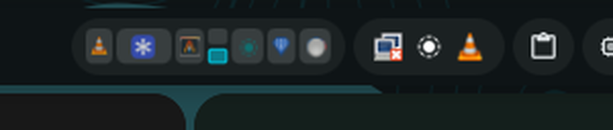

# Niri Minimap

A DankBar widget for [DankMaterialShell](https://github.com/AvengeMedia/DankMaterialShell) that shows a horizontal minimap of the windows on your current [niri](https://github.com/YaLTeR/niri) workspace.



Each tile is a window: columns and rows are laid out to scale, the focused window is highlighted, urgent windows turn red, and app icons are drawn inside each tile.

- Click a tile to focus that window
- Middle-click a tile to close it
- Scroll over the minimap to move focus between columns
- Right-click the bar pill to toggle the niri overview
- Works with stacked and tabbed columns, and can optionally show floating windows

## Requirements

- DankMaterialShell (DMS) `>= 1.0.0`
- niri running the same session as DMS

## Installation

### Manual

```bash
git clone https://github.com/caulifluoride/minimap.git \
  ~/.config/dms/plugins/niriMinimap
dms ipc call plugin-scan scan
```

Then open **Settings → Plugins**, enable **Niri Minimap**, and add it to your DankBar layout in **Settings → DankBar**.

On older DMS releases the plugins directory is `~/.config/DankMaterialShell/plugins` instead.

### One-liner

```bash
curl -fsSL https://raw.githubusercontent.com/caulifluoride/minimap/main/install.sh | bash
```

The script clones (or updates) the plugin in the right directory, rescans plugins, and enables it.

### Plugin registry

Niri Minimap is published to the [DMS plugin registry](https://plugins.danklinux.com/), so you can install it from **Settings → Plugins → Browse** or from a terminal:

```bash
dms plugins install niriMinimap
```

## Configuration

| Setting | Description | Default |
| --- | --- | --- |
| Workspace | Follow the active workspace on this monitor, or the focused workspace on any monitor | Active on this monitor |
| Maximum width | Columns are squeezed horizontally once the minimap reaches this width | `320 px` |
| Show app icons | Draw the app icon inside each window tile | on |
| Show floating windows | Append floating windows after the tiled columns | off |

## Development

Symlink a checkout into the plugins directory and reload it after edits:

```bash
ln -sfn "$PWD" ~/.config/dms/plugins/niriMinimap
dms ipc call plugins reload niriMinimap
```

`dms ipc call plugins list` shows what is currently loaded.
